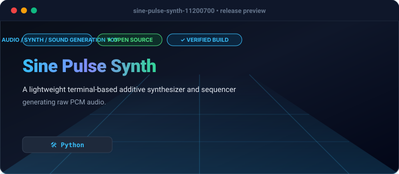

# Sine Pulse Synth

[](https://github.com/Olamideakinade/sine-pulse-synth-11200700)
[](https://opensource.org/licenses/MIT)



Sine Pulse Synth is a command-line additive synthesizer and step sequencer that renders multi-harmonic audio directly to raw PCM streams or wave files. It is designed to experiment with procedural audio generation, additive synthesis, and frequency modulation without heavy digital audio workstation dependencies.

## Key Capabilities

- **Additive Synthesis Engine**: Combines up to 8 harmonic overtones with customizable amplitude scaling and phase offsets.
- **Step Sequencer**: Implements a rhythmic pattern scheduler supporting note triggers, rests, and velocity scaling.
- **WAV & PCM Export**: Renders output directly to standard 16-bit PCM WAV files or outputs raw data to stdout for piping into audio players.
- **Deterministic Rendering**: Generates identical audio buffers given the same patch configuration and seed.

## Terminal Demonstration

```bash
$ python3 main.py play --harmonics 1,0.5,0.25 --tempo 120 --pattern "C4,E4,G4,B4" --duration 4
[INFO] Initialized synthesizer engine at 44100 Hz
[INFO] Compiling pattern: ['C4', 'E4', 'G4', 'B4'] at 120 BPM
[INFO] Rendering 4.0 seconds of audio to output.wav
[SUCCESS] Render complete. File written to output.wav (352.8 KB)
```

## Quickstart

Clone the repository and run the test suite to verify your environment:

```bash
git clone https://github.com/Olamideakinade/sine-pulse-synth.git
cd sine-pulse-synth
python3 -m unittest discover tests
```

Generate a default sequence and write it to disk:

```bash
python3 main.py generate --output track.wav --tempo 140 --harmonics 1,0.3,0.1
```

## Architecture & Design

- `main.py`: CLI entrypoint handling argument parsing, subcommand routing, and high-level execution flow.
- `engine.py`: Core digital signal processing (DSP) implementation, oscillator math, frequency tables, and buffer assembly.
- `tests/test_core.py`: Unit tests validating mathematical accuracy of frequency conversion, wave generation bounds, and file I/O.

## License

MIT License. See `LICENSE` for details.
